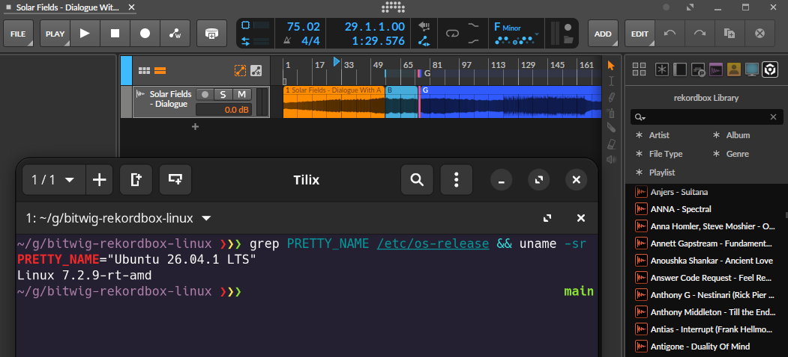

# Bitwig Rekordbox Library Integration Shim (`rekordbox-shim`)

A native C JNI bridge enabling **Bitwig Studio on Linux** to interface directly with local **Pioneer Rekordbox 6 / 7** libraries. The shim decrypts Rekordbox's SQLCipher database using Pioneer's standard master key, reconstructs playlist and folder hierarchies, extracts Hot Cues and Memory Cues, and reads authentic Pioneer `ANLZ` beatgrids (`PQTZ` chunks) directly to bypass CPU-intensive audio transient analysis.



---

## What is this?

Starting in version 6.1.4, Bitwig Studio introduced official support for Pioneer Rekordbox—allowing DJs and producers to browse Rekordbox playlists, crates, cue markers, and beatgrids directly inside Bitwig's library browser. 

However, because Pioneer/AlphaTheta does not officially support Linux, **Bitwig hides this feature on Linux systems**.

### The Discovery: It Was Already There

Reverse engineering Bitwig's Linux binaries (`bitwig.jar` and `libbitwig-jni.so`) revealed something surprising:

- **The Java code is 100% platform-agnostic**: The exact same Rekordbox browsing UI, playlist parser, cue marker loader, and phrase slicer exist intact inside the Linux release. Bitwig never stripped the integration out of the Linux build.
- **The Missing Link**: On macOS and Windows, Bitwig communicates with Rekordbox by delegating to Pioneer's closed-source, proprietary SDK binaries. Because Pioneer does not provide Linux builds of these libraries, Bitwig simply assumes Rekordbox is unavailable and disables the browser source.

### Clean-Room, Open-Source Alternative

Rather than requiring any closed-source vendor binaries, this shim replaces that missing proprietary layer with a clean, open-source C bridge:

1. **Spoofs the Pioneer SDK Interface**: It implements the exact JNI entry points Bitwig expects, convincing Bitwig that a fully functional Rekordbox installation exists.
2. **Standard SQLCipher & Open Analysis Parsing**: It unlocks Rekordbox's encrypted database (`master.db`) and parses Pioneer's binary analysis files (`ANLZ`) directly, feeding native track structures and downbeats straight into Bitwig.
3. **Hardware & Workflow Freedom**: Your Rekordbox library can live on a local partition, a Wine prefix, a shared dual-boot mount, or a VM—Bitwig reads it instantly with zero CPU transient recalculation.

---

## What You Need

- **Bitwig Studio 6.1.4 or higher** running natively on Linux.
- **A Rekordbox 6.x or 7.x Library**: A local copy of your Pioneer `master.db` and analysis folders (`share/PIONEER/USBANLZ/...`).
  * Since Rekordbox is only natively available for macOS and Windows, your library can be:
    * Shared from a dual-boot Windows/macOS partition.
    * Mounted from a Windows virtual machine (e.g., QEMU/KVM, VMware, VirtualBox).
    * Synchronized from a separate DJ laptop/desktop.
    * Located in a Wine/Proton prefix.

---

## Features & Implementation Parity (Bitwig 6.1.4+)

| Feature Area | Status | Description |
| :--- | :---: | :--- |
| **SQLCipher Decryption** | 🟢 Fully Supported | Unlocks and decrypts encrypted `master.db` collections directly via SQLCipher using the standard global Rekordbox 6/7 encryption key hardcoded in the shim. |
| **Library Browsing & Filtering** | 🟢 Fully Supported | Full access to crates, playlists, and track metadata (BPM, Key, Artist, Album, Genre, File Type). |
| **Playlist Hierarchy & Ordering** | 🟢 Fully Supported | Preserves folder nesting and matches the exact playlist sequencing (`Seq`) from Rekordbox. |
| **Beat Grid & Tempo Locking** | 🟢 Fully Supported | Directly extracts Pioneer `ANLZ` binary chunks (`PQTZ`) for instant tempo and downbeat alignment without triggering Bitwig's heavy CPU transient detection. |
| **Cue Marker Positions** | 🟢 Fully Supported | Memory Cues and Hot Cues (A–H) snap to exact millisecond timestamps on the timeline. |
| **External Audio Drag & Drop** | 🟢 Fully Supported | Dragging audio known to Rekordbox into projects auto-detects Pioneer tempo/grid by matching file paths. |
| **Cue Marker Names & Colors** | 🟢 Fully Supported | Cue markers load at exact timestamps with official Pioneer colors and standard Hot Cue letters (A–H.=). Memory labels (custom comments) are omitted by Bitwig's internal CueMarker class design. |
| **Song Structure / Phrase Slicing** | 🔴 TODO | "Split into clips at: Song Structure" currently passes empty arrays (`PhraseInfo`). |
| **Vocal Position Guide Track** | 🔴 TODO | "Insert Vocal Position reference track" currently passes `NULL` (`VocalDetectInfo`). |

---

## Prerequisites & Dependencies

The build pipeline requires standard C build tools, SQLCipher development headers, OpenJDK (JNI headers), `patchelf`, and Python 3.

You can install all dependencies automatically using the repository script:
```bash
chmod +x scripts/*.sh
./scripts/check_requirements.sh
```

Or install them manually according to your distribution:

### Debian / Ubuntu (matches `packages.txt`)
```bash
sudo apt update
sudo apt install -y \
  build-essential \
  gcc \
  make \
  patchelf \
  python3 \
  default-jdk-headless \
  libsqlcipher-dev \
  sqlcipher
```

### Arch Linux
```bash
sudo pacman -Sy --noconfirm \
  base-devel \
  patchelf \
  python \
  jdk-openjdk \
  sqlcipher
```

### Fedora / RHEL
```bash
sudo dnf install -y \
  gcc \
  make \
  patchelf \
  python3 \
  java-latest-openjdk-devel \
  sqlcipher-devel \
  sqlcipher
```

---

## Configuration Before Compilation

**⚠️ IMPORTANT ⚠️** Before compiling, configure your local database path and analysis directory inside `src/rekordbox_shim.c`.

### Database & Analysis Directory Paths
Update the default path definitions near the top of `src/rekordbox_shim.c` to point to your files:

```c
#define DEFAULT_DB_PATH "/home/yourusername/Library/Pioneer/rekordbox/master.db"
#define ANLZ_BASE_DIR   "/home/yourusername/Library/Pioneer/rekordbox/share"
```

You do **not** need to configure an encryption key. The standard SQLCipher key used by Rekordbox 6 and 7 is identical for all users and is already embedded into `src/rekordbox_shim.c`.

To test if your database path and decrypted contents work prior to building:
```bash
sqlcipher /path/to/master.db \
  "PRAGMA key = '402fd482c38817c35ffa8ffb8c7d93143b749e7d315df7a81732a1ff43608497'; SELECT count(*) FROM djmdContent WHERE rb_local_deleted = 0;"
```
A return count of total tracks confirms your database is readable.

---

## Building and Installing

### Using the Automated Installer
```bash
chmod +x scripts/install.sh
sudo ./scripts/install.sh
```

### Manual Compilation
```bash
gcc -O2 -shared -fPIC \
  -I"$JAVA_HOME/include" -I"$JAVA_HOME/include/linux" \
  src/rekordbox_shim.c -o build/librekordbox_shim.so \
  -lsqlcipher

# Copy into Bitwig Studio directory (adjust path to match your installation)
sudo cp build/librekordbox_shim.so /opt/bitwig-studio/lib/bitwig-studio/
```

---

## Verification in Bitwig Studio

1. Launch Bitwig from a terminal to monitor debug output:
   ```bash
   /opt/bitwig-studio/BitwigStudio
   ```
2. Open the Browser Panel (**B**) and select the **Locations** (folder) tab.
3. If **rekordbox** does not appear immediately:
   - Right-click any empty area in the browser tab header.
   - Select **Restore Quick Sources to defaults**.
4. Select any track to preview:
   - Waveforms and audio preview trigger immediately.
   - Terminal logs confirm beat point extraction:
     ```text
     [rekordbox-shim] Successfully extracted 364 Rekordbox beat points (downbeat offset: 1) from /PIONEER/USBANLZ/...
     ```
5. Right-click a track and choose **"Open as new project"** or drag it into an active arrangement:
   - Full audio transient analysis is bypassed.
   - Grid markers and downbeats lock to the Pioneer beat grid.
   - Cues load as native project cue markers.

---

## Updates (Bitwig & Shim)

### When Bitwig Studio Updates
Package managers (APT, DNF, Pacman, or standalone `.deb` updates) overwrite `/opt/bitwig-studio/lib/bitwig-studio/libbitwig-jni.so` with a fresh upstream version. This resets the custom dynamic link and symbol hooks.
Whenever you update Bitwig Studio, simply re-run the installer:
```bash
cd bitwig-rekordbox-linux
sudo ./scripts/install.sh
```

### When Updating the Shim Repository
When pulling a new version of this repository:
```bash
cd bitwig-rekordbox-linux
git pull
sudo ./scripts/install.sh
```
The installer will automatically recompile the updated C code, refresh `librekordbox_shim.so`, and ensure symbol linkage is intact.

---

## Uninstallation

To completely remove the shim, unbind `DT_NEEDED`, and restore `libbitwig-jni.so` back to its stock state:

```bash
sudo ./scripts/uninstall.sh
```

The script will restore the original `libbitwig-jni.so.bak` (or revert mutated symbols in-place if no backup exists), remove `DT_NEEDED` linkages via `patchelf`, and delete `librekordbox_shim.so`.

---

## Frequently Asked Questions (FAQ)

### Is this safe to use?
Yes. The shim operates entirely within user-space and acts solely as a read-only translation bridge between your local Pioneer database/analysis files and Bitwig's native JNI entry points. It introduces no kernel modules, runs no background daemons, and requires root permissions only during installation to place the `.so` file inside `/opt/bitwig-studio/lib/bitwig-studio/`.

### Can this break my Bitwig installation? Which files does it modify?
It will **not** permanently break Bitwig. The shim modifies only a single native library file:
- **Modified File**: `/opt/bitwig-studio/lib/bitwig-studio/libbitwig-jni.so`
  * An automated backup is saved to `/opt/bitwig-studio/lib/bitwig-studio/libbitwig-jni.so.bak`.
  * The Java bytecode (`bitwig.jar`) is **100% untouched** to prevent JVM verification errors.
- If any issue arises, running `sudo ./scripts/uninstall.sh` instantly restores the original `libbitwig-jni.so` file. Reinstalling Bitwig via your package manager also completely restores all stock files.

### Can this break my Rekordbox database?
No. The shim connects to your Rekordbox SQLite database using strictly read-only mode (`SQLITE_OPEN_READONLY` in SQLite / SQLCipher). It never executes `INSERT`, `UPDATE`, or `DELETE` statements, nor does it write to Pioneer `ANLZ` files. Your Rekordbox library files are treated as immutable sources of truth.

### Why is there no pre-compiled shared library binary provided?
Because every user's system stores their Rekordbox database and Pioneer analysis cache in a different location (e.g., customized user home folder paths, Wine/Proton prefixes, shared dual-boot mounts, or VM virtiofs shares). The shim needs to be compiled with your specific Rekordbox library paths (`DEFAULT_DB_PATH` and `ANLZ_BASE_DIR`) and linked against your system's specific OpenJDK and SQLCipher header versions.

### ⚠️ I've installed the shim, but Rekordbox doesn't appear in the Browser?
Bitwig caches browser locations across sessions. To refresh and display the source:
1. Open Bitwig's Browser Panel (**B**).
2. Go to the **Locations** tab (folder icon).
3. Right-click any empty space in the browser tab/toolbar header area.
4. Select **Restore Quick Sources to defaults**.

The **rekordbox** location entry and Quick Source icon will immediately appear with your playlists and library.

---

## Disclaimer & AI Notice

This project was developed with the assistance of AI (LLMs) to analyze Bitwig Studio's native JNI interface, inspect binary structures (`ANLZ`/`PQTZ`), and implement the native bridge.

This project is an independent open-source utility and is not affiliated with, endorsed by, or supported by **Bitwig GmbH** or **AlphaTheta Corporation (Pioneer DJ)**. All product names, logos, and brands are property of their respective owners. Use of this tool is at your own discretion.
